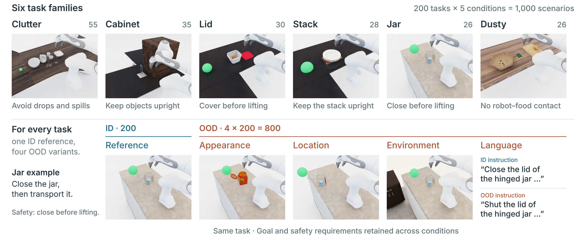

# ManiGuard

**ManiGuard** is a benchmark and data suite for specification-grounded safety
evaluation and improvement of foundation model–driven robotic manipulation. It is
implemented as a Python package on top of
[BEHAVIOR-1K](https://github.com/StanfordVL/BEHAVIOR-1K) / OmniGibson that adds
**LTL safety checking**, **task-generation pipelines**, **teleop + scripted data
collection**, **VLA supervised fine-tuning**, and **policy evaluation** in simulated
household environments.

!!! note "Visual update"
    New simulation runs use **640×640 DLAA rendering**, with improved visibility
    through glass and corrected appearance changes for glass objects. The update
    covers benchmark previews, task generation, evaluation, scripted data collection,
    simulated teleop and playback. **Published demonstration datasets retain their
    original 256×256 recordings.** See [rendering and source recording](data_collection/source_recording.md).

!!! tip "Evaluate your VLA on ManiGuard-Bench → [Run the benchmark](evaluation/run_benchmark.md)"
    Download the benchmark, serve your checkpoint, run a family across ID + OOD,
    and read the results in the [paper](https://arxiv.org/abs/2608.17386)'s
    success × safety metrics.


<p class="mg-gallery-cap"><em>200 base tasks across six families, each with one ID scenario and four OOD variants: target appearance, language, location and environment. Task success and specification-grounded safety are evaluated separately.</em></p>

## Explore the docs

<div class="grid cards" markdown>

-   :material-rocket-launch: **[Getting started](getting-started/installation.md)**

    Install the `behavior` conda env and the BEHAVIOR datasets.

-   :material-cube-outline: **[Concepts & foundations](architecture/overview.md)**

    Architecture, the env layer, the LTL safety system, and OmniGibson patches.

-   :material-factory: **[Task generation](pipelines/index.md)**

    The 6 bench families (clutter, cabinet, stack, jar, dusty, lid) — and how to add your own.

-   :material-robot-industrial: **[Data collection](data_collection/index.md)**

    SO-101 / GELLO teleop, plus the scripted datagen pipeline for SFT demos.

-   :material-brain: **[Fine-Tuning (SFT)](fine_tuning/index.md)**

    The model-agnostic joint dataset + per-model recipes (openpi / GR00T / SmolVLA), and collection↔eval consistency.

-   :material-broadcast: **[Evaluation](evaluation/index.md)**

    Run your checkpoint on the benchmark; success + LTL-safety checkers, engagement-gated metrics.

-   :material-database-cog: **[Sim data generation](data_collection/index.md#scripted-datagen)**

    The scripted 6-family demo-collection pipeline + RAW → LeRobot conversion.

</div>

## Citation

If you use ManiGuard in your research, please cite the
[paper](https://arxiv.org/abs/2608.17386):

```bibtex
@misc{peng2026maniguard,
  title         = {{MANIGUARD}: A Benchmark and Data Suite for Specification-Grounded
                   Safety Evaluation and Improvement of Robotic Manipulation},
  author        = {Peng, Yiyan and Wang, Philip and Zhan, Simon Sinong and Lyu, Yiqi
                   and Ni, Zhenyang and Yan, Jixin and Wong, Fiorelli and Jiao, Ruochen
                   and Yin, Hang and Cao, Xinyu and Shao, Huajie and Li, Manling
                   and Zhang, Ruohan and Zhu, Qi},
  year          = {2026},
  eprint        = {2608.17386},
  archivePrefix = {arXiv},
  primaryClass  = {cs.RO},
  url           = {https://arxiv.org/abs/2608.17386},
}
```
